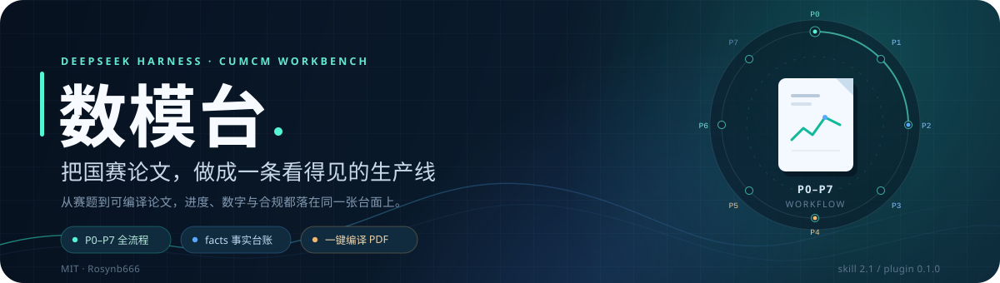
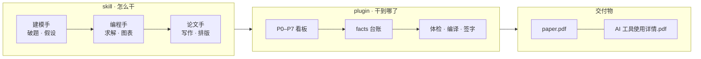

<div align="center">



<br>

<a href="LICENSE"></a>


**给 DeepSeek Harness 的国赛论文工作台 · skill + plugin**

<a href="#它能做什么">能力</a> ·
<a href="#工作流">工作流</a> ·
<a href="#快速开始">安装</a> ·
<a href="#交付前的四道闸">体检</a> ·
<a href="#已验证与边界">边界</a>

</div>

---

**数模台**把国赛论文从「聊天记录里的灵光」变成「磁盘上的产物链」：赛题、假设、代码、`facts.json`、图表、`paper.tex`、PDF 和 AI 使用材料都落在同一个工作区里，进度和数字不靠记忆。

它不是一个「一键交稿器」。它把三件最容易在截止日前翻车的事做成硬约束：**数字可追溯、AI 使用可披露、排版可体检**。核心建模与分析仍由参赛队完成，签字必须由人落笔。

> [!IMPORTANT]
> 数模台不替你参赛，也不承诺获奖。它负责把重复劳动、数字对账和交付检查做扎实；论文里的判断、取舍与责任，仍然是人的。

## 两件套

| 部件 | 负责什么 | 入口 |
| :--- | :--- | :--- |
| **Skill** `math-modeling-cumcm` | 三角色工作流：建模手 / 编程手 / 论文手；2025 规范、9 个脚本、LaTeX 模板 | [skill 文档](skill/math-modeling-cumcm/README.md) |
| **Plugin** `dsh-cumcm` | 右侧栏「数模台」：P0–P7 进度、facts 台账、过程视图、一键体检编译、PDF 预览、签字卡 | [插件文档](plugin/dsh-cumcm/README.md) |

> **skill 负责「怎么干」，plugin 负责「干到哪了、数字对不对、能不能交」。**

## 它能做什么

| | 能力 | 落点 |
| :---: | :--- | :--- |
| 📍 | **P0–P7 全流程看板** | 从磁盘产物判断环境、破题、建模、求解、写作、图表、自检、合规，不依赖对话记忆 |
| 🧾 | **facts 事实台账** | 每个数字都有单位、来源脚本和对照检验；正文只写 `\res{key}`，由脚本注入 |
| ⚡ | **一键动作** | render / check / layout / appendix / compile / AI 报告，面板里直接跑 |
| 📄 | **PDF 直接看** | 论文和《AI 工具使用详情》都在侧栏预览，不用翻文件夹 |
| 🖊️ | **人工签字卡** | 审核人、日期、审核范围、改动清单落成 `review_signoff.md`，AI 不能代签 |
| 🔒 | **克制的安全模型** | 同源校验、白名单读文件、`projectsRoot` 目录限制、参数数组启动子进程 |

## 工作流



三个角色不是三个聊天窗口，而是同一条产物链上的三种职责。插件只读工作区里的文件，不维护第二份「真相」。

## 三条硬约束

### 1. 论文里的数字不能手写

正文里的计算结果统一写成占位符：

```latex
均方根误差为 \res{rmse}，较基准下降 \res{cost_drop_pct}\%。
```

`render.py` 从 `facts.json` 注入数值；`check.py` 会扫正文里的裸小数和百分比。改模型、换参数、重跑实验，数字跟着台账走，不靠人肉同步。

### 2. AI 使用必须披露，人必须签字

- 每段 AI 起草的文字带 `\aiflag{1}`，参考文献列 AI 工具条目；
- `ai_log/changes.md` 记录至少 5 条实质改动；
- `review_signoff.md` 由队员手填，`check.py --strict` 会核对签字栏；
- `ai_report.py` 生成 PDF 版《AI 工具使用详情》。

不提供「降 AI 率 / 绕过检测」功能。新规是披露制，如实披露才是合规路径。

### 3. 排版必须过机器体检

`layout.py` 按 2025 规范检查页边距、摘要页数、图表编号与引用、三线表、附录源码、身份信息泄露和正文页数。`compile.py` 再跑 render + xelatex ×2，把 PDF 和首个错误一起交回来。

## 快速开始

### 0. 环境

| 依赖 | 要求 |
| :--- | :--- |
| Python | ≥ 3.10 |
| LaTeX | `xelatex` + `ctex` + `xeCJK` |
| Node.js | ≥ 22（插件宿主） |
| DSH | 在 `0.2.1-rc.3` 实测 |

> 目前只在 **Windows 11 + MiKTeX 26.5** 做过完整真机验证。macOS / Linux 需要自己调整模板里的中文字体（`fontset`），详见 [skill 文档](skill/math-modeling-cumcm/README.md#常见坑)。

### 1. 取回项目

```powershell
git clone https://github.com/Rosynb666/dsh-cumcm.git
cd dsh-cumcm
```

### 2. 安装 skill

```powershell
Copy-Item .\skill\math-modeling-cumcm "$env:USERPROFILE\.dsh\skills\" -Recurse
```

### 3. 安装插件

DSH 自带 CLI，不在 PATH 里：

```powershell
$dsh = "$env:LOCALAPPDATA\Programs\DeepSeek Harness\resources\runtime\cli\bin\dsh.cmd"
& $dsh plugin --profile desktop add "file:$PWD\plugin\dsh-cumcm"
```

刷新 DSH 页面，右侧栏出现「数模台」就装好了。手工安装、配置项和宿主接口见 [插件文档](plugin/dsh-cumcm/README.md)。

### 4. 跑第一道题

1. 在「数模台」面板里新建工作区（用题目关键词命名，不绑年份）；
2. 把赛题、数据放进 `problem/`，让 agent 按 skill 的 P0–P7 推进；
3. 在面板里点「体检」「编译」，或直接看 PDF。

不装插件也能单用 skill：

```powershell
cd .\skill\math-modeling-cumcm
python scripts/preflight.py
python scripts/compile.py "C:\path\to\work\你的题目"
```

## 交付前的四道闸

| 闸门 | 它检查什么 |
| :--- | :--- |
| `render.py` | `facts.json` → `\res{}`，查残留占位符 |
| `check.py --strict` | 数字溯源、AI 标注、引用、签字、合规材料 |
| `layout.py` | 页边距、页数、图表标题与引用、三线表、身份信息 |
| `compile.py` | render → xelatex ×2 → PDF，报页数与首个错误 |

四道都过，再谈「可提交」。任何一道红灯，面板里都能看到原因。

## 项目结构

```text
.
├── skill/math-modeling-cumcm/
│   ├── SKILL.md              # 工作流入口
│   ├── references/           # 论文结构 / 图表 / 合规 / 评审清单
│   ├── scripts/              # preflight → render → check → layout → compile
│   ├── templates/            # analysis / facts / paper.tex
│   └── examples/demo/        # 一条完整链路样例
├── plugin/dsh-cumcm/
│   ├── lib/                  # 宿主路由 + 浏览器面板
│   ├── test/                 # 接口与客户端测试
│   └── docs/LESSONS.md       # 编码、沙箱、HMR 踩过的坑
└── docs/assets/              # README 视觉素材
```

## 已验证与边界

| 项 | 状态 |
| :--- | :--- |
| Windows 11 · DSH 0.2.1-rc.3 · MiKTeX 26.5 | ✅ 完整真机验证 |
| 模板编译 | ✅ 7 页 PDF，`render → xelatex ×2` |
| 冷启动工作区 | ✅ appendix → render → check → layout → compile → AI 报告全链路 |
| macOS / Linux | ⚠️ 未实测；需调整中文字体与 LaTeX 环境 |
| 子进程自动化测试 | ⚠️ 沙箱会拦管道 stdio，这部分走真机手测 |
| 版本状态 | 早期版本（plugin 0.1.0）；接口可能随宿主升级调整 |

## 开发

```powershell
cd .\plugin\dsh-cumcm
npm install
npm test
```

宿主侧用真实 HTTP server 跑接口测试，客户端侧跑注册契约与 React 首屏渲染。提交前请同步更新 skill 与 plugin 的版本说明。

## 参与

- 遇到问题、想要新能力：[开 issue](https://github.com/Rosynb666/dsh-cumcm/issues)；
- 想改代码：先读 [插件文档](plugin/dsh-cumcm/README.md) 和 [LESSONS.md](plugin/dsh-cumcm/docs/LESSONS.md)，PR 保持 skill / plugin 同步；
- 只想要工作流：直接拷 `skill/`，不装插件也能用。

## 许可

MIT，署名 **Rosynb666**。可以自由使用、修改、再分发，保留版权声明即可。

<div align="center">
<sub>如果数模台帮你少对了一次数、少熬了一个小时，欢迎点一个 ⭐</sub>
</div>
